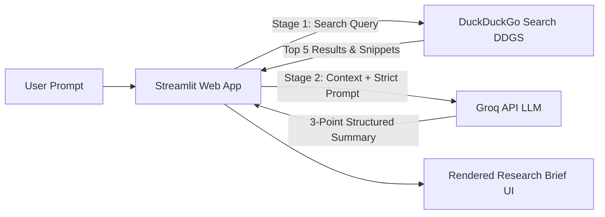

# 🔎 AI Research Brief Generator (Task Automation Agent)

[](https://github.com/parth-ladage/experiment-10-task-automation-agent/actions/workflows/ci.yml)
[](https://www.python.org/downloads/)
[](https://streamlit.io)
[](https://www.docker.com/)
[](https://groq.com/)

An automated web research and summarization agent built with **Streamlit**, **DuckDuckGo Search**, and **Groq Cloud API**. Enter any research topic, and the agent autonomously searches the web for current sources and delivers an accurate, concise 3-point executive research brief.

---

## 📑 Table of Contents

- [Overview](#-overview)
- [Architecture & Workflow](#-architecture--workflow)
- [Key Features](#-key-features)
- [Tech Stack](#-tech-stack)
- [Repository Structure](#-repository-structure)
- [Getting Started](#-getting-started)
  - [Prerequisites](#prerequisites)
  - [Local Installation](#local-installation)
  - [Environment Variables & Secrets](#environment-variables--secrets)
  - [Running the Application](#running-the-application)
- [Docker Deployment](#-docker-deployment)
- [CI/CD Automation](#-cicd-automation)
- [Configuration Reference](#-configuration-reference)
- [License](#-license)

---

## 🌟 Overview

Conducting ad-hoc web research often involves sifting through multiple search results, ads, and lengthy web pages. **AI Research Brief Generator** automates this two-stage pipeline:
1. **Live Web Retrieval:** Queries DuckDuckGo to obtain relevant search results (titles, links, and text snippets).
2. **LLM Summarization:** Feeds gathered context into Groq's ultra-low latency inference engine to extract high-signal insights formatted as a grounded, 3-point brief with zero hallucination.

---

## 🏗 Architecture & Workflow



### Execution Steps
1. **User Input:** User submits a research topic via the Streamlit interface.
2. **Stage 1 (Web Retrieval):** `DDGS.text()` retrieves the top 5 most relevant results from DuckDuckGo.
3. **Stage 2 (Inference):** The titles, URLs, and summaries are formatted and transmitted to Groq with strict prompt constraints (temperature: 0.2, exactly 3 bullet points, no fabricated facts).
4. **Display:** The brief is rendered cleanly in Markdown for immediate consumption.

---

## ✨ Key Features

- **Automated Two-Stage Pipeline:** Seamless transition from live web querying to LLM synthesis.
- **Strict Anti-Hallucination Guardrails:** Prompt-engineered to ground outputs strictly on retrieved search snippets.
- **Ultra-Fast Inference:** Powered by Groq Cloud for near-instant responses.
- **Dual Secret Management:** Seamlessly reads keys from OS environment variables or Streamlit secrets (`st.secrets`).
- **Containerized & Portable:** Dockerfile configured for standard container runtimes and Cloud environments (e.g., Hugging Face Spaces, Render, or Streamlit Cloud).
- **CI/CD Integration:** Automated syntax linting and container build validation via GitHub Actions.

---

## 🛠 Tech Stack

| Component | Technology | Description |
| :--- | :--- | :--- |
| **Frontend / App Server** | [Streamlit](https://streamlit.io/) (`>=1.40.0`) | Interactive web interface |
| **Search Engine API** | [ddgs](https://github.com/deedy5/duckduckgo_search) (`>=9.0.0`) | DuckDuckGo search library |
| **LLM Inference Provider** | [Groq](https://groq.com/) via [OpenAI Python SDK](https://github.com/openai/openai-python) (`>=1.60.0`) | Fast LLM chat completion API |
| **Containerization** | [Docker](https://www.docker.com/) | `python:3.11-slim` runtime image |
| **CI/CD** | [GitHub Actions](https://github.com/features/actions) | Syntax verification & Docker build checks |

---

## 📂 Repository Structure

```text
├── .github/
│   └── workflows/
│       └── ci.yml               # Automated CI pipeline (linting & docker build)
├── docs/                        # Project documentation, reports, and execution logs
│   ├── DS63-GenAI-EXP10.docx
│   ├── DS63-GenAI-EXP10.pdf
│   └── logs.txt
├── .gitignore                   # Ignored files and patterns
├── app.py                       # Main Streamlit application and research pipeline
├── Dockerfile                   # Docker container specification
├── requirements.txt             # Python dependencies
└── README.md                    # Project documentation
```

---

## 🚀 Getting Started

### Prerequisites

- **Python 3.11+** installed on your system.
- A **Groq Cloud API Key** (obtainable free from [Groq Console](https://console.groq.com/keys)).
- *(Optional)* **Docker** installed for containerized execution.

### Local Installation

1. **Clone the repository:**
   ```bash
   git clone https://github.com/parth-ladage/experiment-10-task-automation-agent.git
   cd experiment-10-task-automation-agent
   ```

2. **Create and activate a virtual environment:**
   ```bash
   # Linux / macOS
   python3 -m venv .venv
   source .venv/bin/activate

   # Windows (Command Prompt / PowerShell)
   python -m venv .venv
   .venv\Scripts\activate
   ```

3. **Install the dependencies:**
   ```bash
   pip install --upgrade pip
   pip install -r requirements.txt
   ```

### Environment Variables & Secrets

You can provide your Groq API key in one of two ways:

#### Option A: Shell Environment Variable
```bash
export GROQ_API_KEY="gsk_your_groq_api_key_here"
# Optional: customize model (defaults to openai/gpt-oss-20b)
export GROQ_MODEL="openai/gpt-oss-20b"
```

#### Option B: Streamlit Secrets (Recommended for Streamlit Cloud & Local Dev)
Create a `.streamlit/secrets.toml` file in the root of the project:
```toml
GROQ_API_KEY = "gsk_your_groq_api_key_here"
```

### Running the Application

Launch the Streamlit dashboard:
```bash
streamlit run app.py
```

Open your browser and navigate to:
```text
http://localhost:8501
```

---

## 🐳 Docker Deployment

The application includes a production-ready `Dockerfile` based on `python:3.11-slim`.

### 1. Build the Docker Image
```bash
docker build -t research-brief-agent .
```

### 2. Run the Container
Pass your `GROQ_API_KEY` as an environment variable and expose port `7860`:
```bash
docker run -p 7860:7860 -e GROQ_API_KEY="gsk_your_groq_api_key_here" research-brief-agent
```

Access the application in your browser at:
```text
http://localhost:7860
```

---

## 🔄 CI/CD Automation

This repository uses **GitHub Actions** (`.github/workflows/ci.yml`) to ensure code quality on every push and pull request to the `main` branch:

- **Syntax Validation:** Runs `python -m py_compile app.py` on Python 3.11 to catch syntax and import issues early.
- **Docker Build Check:** Executes `docker build -t experiment-10 .` to verify that the container builds cleanly without dependency conflicts.

---

## ⚙️ Configuration Reference

| Variable / Secret | Description | Default Value | Required? |
| :--- | :--- | :--- | :--- |
| `GROQ_API_KEY` | API key from Groq Console | *None* | **Yes** |
| `GROQ_MODEL` | Groq-hosted LLM model ID | `openai/gpt-oss-20b` | No |

---

## 📜 License

This project was developed for experimental and educational purposes under the **GenAI Task Automation Agent** coursework / experiments. Feel free to use and adapt it for learning and research.

